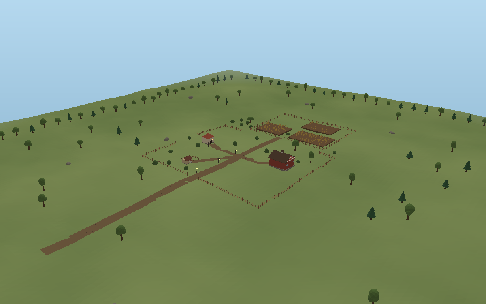

# AI World Builder

A 3D world editor for the browser with lightweight local planning and optional Wikipedia search. Describe a world in
text, inspect and edit it in a Three.js viewport, save it locally, and export it
as a project file or a glTF 2.0 model for Godot and Unity.

> **Phase 3 status:** prompts now become a validated, versioned WorldPlan that is
> built by a structured procedural planner — including a complete cartoon farm
> with a farmhouse, barn, wheat fields, chicken coop, fences, lanes, orchard and
> optional river/bridge. Every generated object is editable, and one object or a
> whole region can be re-rolled in place. Full audit, architecture, risks and
> remaining work are in [`docs/ARCHITECTURE.md`](docs/ARCHITECTURE.md).

---

## تشغيل نسخة الهاتف في Termux (مساعد خفيف + تعلّم تجريبي)

النسخة المصغرة لا تحتاج إلى Qwen أو llama.cpp أو ملف نموذج كبير أو حساب أو مفتاح API. تستخدم تفسيراً محلياً قائماً على كلمات محدودة، ونموذجاً إحصائياً صغيراً يتعلم متوسط الأبعاد من أمثلة مبدئية مصممة للتطبيق ومن العناصر التي تختارها للتدريب. يبني البرنامج هندسة إجرائية لبيت وشجرة عريضة الأوراق وصخرة مستديرة؛ **ليس نموذج لغة أو نموذجاً عاماً يتعلم أشكالاً جديدة من الإنترنت**. يتطلب الاتصال بويكيبيديا قبل كل إنشاء، ويمكن البحث فيها عند الطلب. يبحث التدريب التجريبي للصور في Wikimedia Commons، لا في الإنترنت كله. يتعلم الخادم إحصائياً كلمات قليلة من مقتطفات ويكيبيديا عن التضاريس، لتقدير البيئة فقط؛ لا يتعلم صناعة الأشكال أو تحويل الصور إلى 3D من نصوص ويكيبيديا.

1. أوقف الخادم القديم في Termux بالضغط على Ctrl+C، ثم ثبّت Python وcurl وPillow للصور:

   ```sh
   pkg update && pkg install python curl python-pillow
   ```
2. نزّل **الملفات الأربعة معاً** لتحديث نسختك وشغّل الخادم:

   ```sh
   mkdir -p ~/world-builder && cd ~/world-builder && \
   curl -fL 'https://github.com/benmerfatah0-lang/ai-builder/raw/refs/heads/arena/6c5ab37a-ai-builder/world-builder-mobile.html' -o world-builder-mobile.html && \
   curl -fL 'https://github.com/benmerfatah0-lang/ai-builder/raw/refs/heads/arena/6c5ab37a-ai-builder/world-builder-server.py' -o world-builder-server.py && \
   curl -fL 'https://github.com/benmerfatah0-lang/ai-builder/raw/refs/heads/arena/6c5ab37a-ai-builder/wiki_learner.py' -o wiki_learner.py && \
   curl -fL 'https://github.com/benmerfatah0-lang/ai-builder/raw/refs/heads/arena/6c5ab37a-ai-builder/house_learner.py' -o house_learner.py && \
   python world-builder-server.py
   ```

3. اترك Termux مفتوحاً وافتح **http://127.0.0.1:8080/world-builder-mobile.html** في متصفح الهاتف، ثم حدّث الصفحة. من صفحة Forge اكتب مثلاً «بيت وشجرة وصخرة» واضغط «أنشئ العالم»، ثم «فتح العالم في المحرر». زر Builder يفتح المحرر مباشرة، وGrimoire يفتح مكتبة عوالم هذا التطبيق المحفوظة في المتصفح. إذا كان المنفذ مستخدماً أوقف الخادم القديم أولاً. لإعادة التشغيل لاحقاً: `cd ~/world-builder && python world-builder-server.py`.
4. لتدريب الأشكال اختر بيتاً أو شجرة عريضة الأوراق أو صخرة مستديرة من المشهد، وعدّل حجمها في **Inspect**، ثم افتح **AI**، وافتح «التعلّم والتدريب وحالة المصادر»، واضغط «تعلّم من العنصر المحدد». يعيد ذلك حساب متوسط أبعاد فئتها. أنشئ مشهداً جديداً لرؤية تأثيره؛ البيانات تحفظ في المتصفح ويمكن حذفها من اللوحة. الأشكال المدربة تطبّق على طلبات الأصول الصريحة، لا قالب المزرعة أو النباتات الأخرى.
5. **تعلّم الخرائط التلقائي:** عند فتح الصفحة وظهورها يجرّب التطبيق كل نحو 45 ثانية خرائط صغيرة من أوصاف محلية اصطناعية. يقارن تجربة جديدة بالسابقة على الوصف والبذرة نفسيهما وفق معايير بسيطة للتوزيع وتنوع الأنواع والتحذيرات، ويحتفظ بالتغييرات المقبولة في المتصفح. يغير ثلاثة معاملات لكثافة الأشجار والصخور والمباني للمناظر العامة فقط؛ لا يغير الأعداد الصريحة، أو تخطيط الأصول المحددة، أو قالب المزرعة. يتوقف عندما تكون الصفحة مخفية أو مغلقة ويمكن إيقافه أو حذفه من لوحة AI. قد يستهلك بعض البطارية والمعالج، ولم يُقَس على هاتف حقيقي.
6. هذا التقييم ليس تقييماً بشرياً لجودة التصميم أو متعة اللعب؛ التدريب المحلي للخرائط لا يقرأ الإنترنت، ولا يعلّم المساعد هندسة جديدة أو كيفية بناء مراحل قابلة للعب، ولا يضمن التحسّن المستمر أو بلوغ الاحتراف. لا يؤثر تعطيل التدريب على إنشاء المشهد بعد التحقق من الإنترنت.
7. يبحث التطبيق تلقائياً عن الكلمات التي يشتبه بأنها غير معروفة في ويكيبيديا وويكاموس وWikimedia Commons كما هو موضح أدناه. ويمكن كتابة «ابحث» لطلب البحث عن وصف معروف في ويكيبيديا. فشل التحقق من الاتصال يمنع الإنشاء؛ فشل البحث التلقائي عن كلمة يظهر بوضوح ولا يمنع إنشاء عالم تقريبي بالعناصر المعروفة.

### البحث التلقائي عن الأشياء غير المعروفة

عند إنشاء عالم، يفحص المساعد الوصف تلقائياً؛ إذا رصد كلمات يشتبه أنها غير معروفة، حتى بجانب عناصر يعرفها، يبحث عن جميع الموضوعات التي يقدّر أنها مجهولة في ويكيبيديا وWikimedia Commons، وللكلمة المفردة يبحث أيضاً في ويكاموس، ويعرض المقتطفات وروابط المصادر وصوراً مصغرة مع المؤلف والترخيص. عند فشل أمر تعديل نصي، يبحث أيضاً عن الكلمات غير المعروفة المحتملة، وقد يبني عناصر تقريبية من صور مناسبة أو يضيف نموذجاً من المكتبة تقريبياً في الحالات المحدودة أدناه. لا يلزم حفظ مرجع أو فتح مكتبة. قد يصنّف تعريف صريح محدود في مقالة مطابقة الموضوع ضمن فئة متاحة في المكتبة ويستخدم نموذجها تقريبياً؛ في الأوصاف المركّبة غير المدعومة قد يُهمل العنصر المجهول ويظهر تحذير. فشل أي مصدر يظهر منفصلاً ولا يمنع إنشاء عالم تقريبي.

التعرّف قائم على قاموس وقواعد محدودة وليس فهماً عاماً؛ قد يبحث عن كلمة معروفة أو يفوّت كلمة مجهولة، قد يخطئ في تقسيم الموضوعات أو يتجاهل كلمة؛ لا يوجد حد لموضوعين، لكن وصف الإنشاء لا يتجاوز 4000 حرف وأمر التعديل لا يتجاوز 400 حرف، وحد الاستعلام الواحد للمصادر 400 حرف. يجري بحث موضوعين بالتوازي كحد أقصى ويظهر التقدم، ويمكن إيقافه. لكل موضوع تُحمّل صفحة أولى، وتسمح أزرار «المزيد» بمتابعة صفحات المقالات والصور التي يتيحها المصدر بدلاً من سقف إجمالي ثابت. تحميل صفحات إضافية ليس تلقائياً لتجنب تنزيل نتائج هائلة على الهاتف؛ قد يفرض Wikimedia حدوداً أو يتوقف الاتصال. تُرسل كلمات البحث إلى ويكيبيديا وCommons، والكلمات المفردة إلى ويكاموس تلقائياً، يعرض المتصفح المصغّرات عبر خادم الهاتف، الذي يحمّل روابط Commons الموثوقة فقط وبحجم محدود؛ إذا تعذّر ذلك يحاول المتصفح تحميلها مباشرة من Wikimedia. إذا فشلت الطريقتان يظهر تنبيه ورابط المصدر وزر لإعادة تحميل الصور. يقبل الخادم مصغرات Wikimedia الموثوقة الحديثة على thumb.wikimedia.org بحجم قياسي 250px أو المصغرات القديمة على upload.wikimedia.org، ويحذف معلمات التتبع المعروفة قبل الاستخدام. يعرض البحث الصور المتاحة صفحة بصفحة (حتى 15 ملفاً يفحصها لكل صفحة) بصيغ JPEG أو PNG وبتراخيص CC BY أو CC BY-SA أو CC0 ومع بيانات المؤلف المطلوبة؛ تُستبعد الصور الأخرى لحماية إعادة الاستخدام. راجع المصدر والترخيص وشروط الإسناد قبل إعادة الاستخدام؛ لا يُضمن أن النتائج تطابق الطلب. إذا طابق عنوان مقال ويكيبيديا الموضوعَ، يحاول التطبيق قراءة مقدمته النصية بدلاً من مقتطف البحث فقط. وإذا لم تُرجع الصفحة الأولى صوراً مقبولة للموضوع العربي، يبحث آلياً عن رابط المقالة الإنجليزية ثم يجرّب عنوانها في Commons؛ قد تفشل هذه الخطوة أو لا تتوفر ترجمة مرتبطة. في تقريب البيت المحدود، يحسب التطبيق متوسط لون وسط أول صورة مصغرة ويستخدمه للون جدران البيت إن لم يحدد المستخدم لوناً؛ قد تكون الصورة غير مطابقة أو يكون لون الخلفية. مسار البيت هذا لا يتعرف على محتوى الصورة ولا يستخرج الشكل منها؛ مسار تقريب الصورة المنفصل موضح أدناه.

عندما يوجد موضوع واحد ونتيجة ويكيبيديا مطابقة لعنوانه، قد يستعمل التطبيق كلمات تضاريس محددة في المقتطف لتقدير البيئة فقط، ما لم يحدد المستخدم بيئة أو مزرعة. وإذا احتوى المقتطف تعريفاً محدوداً واضحاً من نوع «هو منزل»، يمكن تمثيل الموضوع بنموذج البيت الموجود في المكتبة. عندما لا تظهر صور مقبولة أو يفشل البحث عنها، يمكن أيضاً مطابقة تعريف صريح لشجرة أو صخرة أو برج أو جسر أو سياج أو فانوس أو كرة مع نموذج تلك الفئة الموجود. هذا تصنيف قاعدي تقريبي لا يستخرج شكلاً من النص وقد يخطئ؛ لا يفهم جميع الأسماء أو التعريفات، ويرفض التطابقات المتضاربة أو المنفية. يتطلب موضوعاً مجهولاً واحداً ومقالة مطابقة أو معنى معجمياً واحداً كاملاً، ولا يخلط الأصل نفسه إذا كان مطلوباً مستقلاً؛ قالب المزرعة مستثنى. يمكن مثلاً أن يضيف «أضف كوخ» بيتاً تقريبياً إذا تطابقت النتيجة واحتوت تعريفاً مدعوماً. يعمل ذلك للإضافة فقط، وليس للأوامر الخطرة كالحذف. يمكن التراجع عنه؛ وإذا تغيّر العالم أو الأمر أثناء البحث لن يُطبَّق. قد تكون النتيجة أو صورة البحث غير مناسبة، فراجعها.

#### التمييز بين الأنواع

يعرض البحث تصنيفاً تقريبياً للكلمة: تضاريس، بايوم، أعشاب، مسطح مائي، حيوان، منشأة، أو غير مؤكد. يعتمد على نوع واضح ملاصق للاسم في الوصف أو تعريف أولي لمقالة مطابقة، وأحياناً معنى معجمي واحد غير مبتور؛ ليس فهماً عاماً وقد يخطئ أو يعجز عن التصنيف. لا يستنتج بيئة العالم من ذكر غابة في مقالة عن حيوان. صور التضاريس والبايومات والأعشاب والمسطحات المائية تُعرض للمراجعة ولا تُحوّل تلقائياً لمجسم صورة.

عند إنشاء عالم جديد فقط، قد يستخدم تعريف جبل أو صحراء أو غابة بيئة عامة موجودة، وقد يمثّل تعريف بحيرة أو بحر بماء عام، وليس خريطة مطابقة للمكان أو شكلاً خاصاً مثل فوهة بركان. لا يدعم بناء كل نوع من التضاريس أو النباتات أو الأنهار من ويكيبيديا. في تعديل عالم موجود لا يُغيّر التضاريس أو الماء تلقائياً من تعريف مجهول؛ يظهر سبب عدم الإضافة بدلاً من وضع صورة، لأن تغيير الأرض قد يؤثر في العناصر الموجودة. يمكن استعمال أدوات المحرر أو إنشاء عالم جديد لوصف البيئة. الحيوانات والمنشآت قد تستخدم استوديو الصور، و«غير مؤكد» لا يعني أن التصنيف قد نجح.

#### استوديو تقريب صورة إلى مجسم

يمكن محاولة عدة عناصر في وصف إنشاء مثل «بيت و2 فيل وزرافة»، أو في تعديل مثل «أضف 2 فيل وزرافة». يفتح استوديو مستقلاً لكل موضوع على التوالي، ويضع النسخ في أماكن متاحة تقريبياً. يوضع العدد قبل الاسم، ويدعم المحلل عدداً محدوداً من صيغ الأعداد. كما يدعم صورة عنصر واحد إلى يمين أو يسار أو أمام أو خلف أو قرب عنصر معروف واحد محدد بوضوح، مثلاً «أضف فيل يمين البيت»؛ يرفض العلاقة إذا وُجد أكثر من مرجع مطابق أو كانت الصياغة غير واضحة. الاتجاه حسب محاور العالم. قد يُساء تحديد الكلمات أو تُتجاهل تفاصيل في الوصف، فراجع الماب والتنبيهات.

للمجسمات المبنية من الصور، الأسلوب الافتراضي الجديد «ناعم»: سطح متصل تتدرج عليه الألوان والحواف والظلال، بدلاً من مكعب مستقل لكل بكسل. اكتب مثلاً «فيل ناعم» أو «فيل بكسلي» ليختار الأسلوب في الحالات التي يفهمها المحلل، أو غيّره من قائمة «أسلوب المجسم» قبل اختيار الصورة. عند طلب أسلوبين متعارضين لا يُختار أحدهما تلقائياً. في وصف متعدد العناصر تُفهم بعض الصفات المجاورة فقط؛ راجع اختيار الاستوديو. اختيار «لوح الصورة كاملة» يظل لوحاً مسطحاً بالخلفية وليس جسماً ناعماً.

تحفظ المجسمات الجديدة أسلوبها مع المشروع ويظهر أيضاً عند تصدير GLB. المجسمات القديمة التي لم يُحفظ لها أسلوب تبقى بكسلية كما هي؛ لتغييرها اختر المجسم في Builder، ثم Inspect ← «أسلوب مجسم الصورة» واختر ناعماً أو بكسلياً. يمكن التراجع عن ذلك. هذا التنعيم يحسن الشبكة لكنه لا يضيف تفاصيل حقيقية أو يعرف الجوانب المخفية؛ الصورة ما تزال مصغرة إلى 24×24، والعمق والخلف مفترضان. الذاكرة والأداء على هاتف فعلي لم يقاسا.

اختر الصورة الأقرب في استوديو البناء حتى لو ظهرت نتيجة واحدة، ويمكن طلب صفحات إضافية؛ لا يبدأ تقريب الصورة قبل اختيارك. إذا كانت الصفحة الأولى فارغة يبحث الاستوديو تلقائياً في صفحة إضافية واحدة، ثم يمكن متابعة الصفحات يدوياً. لا يتحقق التطبيق من أن الصورة تمثّل المطلوب. اختر جسماً كاملاً على خلفية شفافة أو متجانسة، وانتظر بناء الصفوف في موضعها داخل معاينة الماب القابلة للتدوير في Forge، أو في مشهد Builder نفسه. تُحضّر المواقع أولاً، وتكون الطبقات المرئية مسودة مؤقتة لا تُحفظ ولا تدخل Undo حتى تنجح الإضافة. يمكن متابعة البناء عند الانتقال بين Forge وBuilder أو عند إغلاق لوحة AI؛ إذا لم تتوفر WebGL يظهر خطأ العرض. يمكن تخطي عنصر أثناء إنشاء عالم جديد أو إيقاف البقية؛ تظهر تنبيهات بما لم يُبنَ. تُضاف عناصر الإنشاء الناجحة على خطوات مستقلة يمكن التراجع عنها، أما التعديل من عدة صور فيُحفظ دفعة واحدة بعد نجاح الجميع، ويُلغى كاملاً إذا ألغيت أو فشل الإدراج. إذا تغيّر العالم أو الأمر أثناء البناء تُوقف الإضافة. يمكن حفظ الماب وتصديره GLB؛ هذا ليس نشراً عاماً على الإنترنت تلقائياً.

يُنزّل خادم Termux مصغرة موثوقة بحد ميغابايت ويصغرها إلى 24×24 بكسل بحد أقصى؛ يحتاج `python-pillow`. تحاول خوارزمية بسيطة فصل الخلفية المتجانسة من الحواف أو الشفافة ثم تولّد شكلاً ملوّناً تقريبياً؛ خيار السطح الناعم يصل العينات ويقرب حدودها، وخيار البكسل يبقيها مكعبات. **الخلف والعمق مفترضان بتناظر بسيط حول المقدمة، وليس استنتاجاً حقيقياً لما وراء الصورة أو فهماً لنوع الجسم.** النتيجة خشنة وقد تفصل الخلفية أو الجسم خطأ؛ ترفض بعض الصور المعقدة ولكنها لا تكتشف كل الأخطاء. هذه قواعد محدودة وليست فهماً عاماً للوصف: لا تُفهم كل صيغ الجمع أو المقاييس أو الألوان أو العلاقات المعقدة؛ عند تعذّر ضمان موضع العنصر يظهر تحذير ولا يُنشأ في ذلك المسار. لا يُبنى تلقائياً كل شيء في وصف متعدد العناصر، ولا تُحفر التضاريس أو المياه من الصور. الموضع تقريبي والتحقق من التداخل والتضاريس محدودان. الصور والمناظر الفوتوغرافية المعقدة غالباً لا تصلح. عند فشل فصل الجسم يظهر محرّر تحديد يدوي: اضغط نقاطاً حول الجسم على الصورة ثم «بناء المحدد»؛ يمكن التراجع عن آخر نقطة أو مسح التحديد. ويمكن أيضاً تفعيل «أريد تحديد حدود الجسم يدوياً» قبل اختيار الصورة حتى لو نجح الفصل التلقائي. يُحذف خارج الحدود فقط وقد تبقى الخلفية بين أجزاء الجسم، ويؤثر التصغير إلى 24×24 على الدقة؛ راجع النتيجة وتراجع عنها إذا لم تناسبك. لم يُختبر التحديد باللمس على هاتف حقيقي. يمكن أيضاً اختيار صورة أخرى أو إعادة المحاولة؛ يوجد أيضاً خيار صريح لإنشاء لوح رقيق من الصورة كاملة بما فيها الخلفية، وهو ليس مجسماً مفصولاً للجسم. نوع التقريب يُحفظ مع العنصر. الحد الإجمالي 4608 خلايا صورة لكل مشروع لتقليل الحمل، ولم يُقَس الأداء على هاتف فعلي.

تحفظ خلايا اللون والشكل المشتقة واسم ملف الصورة والمؤلف والترخيص ورابطهما في بيانات العنصر داخل المشروع، وفي بيانات extras في GLB؛ عند المشاركة تحقّق بنفسك من متطلبات الإسناد وشروط الترخيص، ولا تفترض أن كل قارئ GLB يعرض بيانات extras. متوسط لون صورة البيت السابق لا يحفظ بيانات مصدره في المشروع. لا تُحفظ الصور الأصلية أو مكتبة مراجع جديدة. المراجع المحفوظة في الإصدار السابق وبيانات التدريب السابقة لا تُحذف تلقائياً.

### التجول داخل العالم الموجود

في Builder اضغط «التجول في العالم» أعلى المشهد. اسحب المشهد لتغيير اتجاه النظر، واضغط أزرار الاتجاهات مطولاً على الهاتف؛ على لوحة المفاتيح استخدم W/A/S/D أو الأسهم. للعودة للكاميرا السابقة اضغط «الخروج من التجول» أو Escape. هذه حركة كاميرا فوق ارتفاع الأرض، وليست شخصية أو محاكاة فيزيائية: لا تمنع المرور عبر الجدران والعناصر ولا تحاكي السباحة. لا تغيّر العالم أو تحوّل الصورة المسطحة إلى بيئة؛ تظهر داخل التجول الأشكال الثلاثية الأبعاد الموجودة فعلاً في المشروع فقط. إذا لم تتوفر WebGL لا يعمل العرض. لم يُختبر التحكم باللمس أو الأداء على هاتف حقيقي.

### تعديل العالم بالكتابة

بعد إنشاء العالم اختر **Builder**، ثم في الهاتف افتح **AI** من الشريط السفلي. في «عدّل عالمك بالكتابة» اكتب أمراً واحداً واضغط «تطبيق التعديل». أمثلة: «أضف شجرتين على يمين البيت»، «لوّن البيت أحمر»، «كبّر البيت»، «احذف البيت»، «حرّك البيت إلى يسار الشجرة». تعمل هذه الأوامر المحدودة محلياً على العالم المفتوح ولا تستبدله بعالم آخر؛ الإنشاء الجديد يظل وظيفة منفصلة. للحذف والتحريك وتغيير الحجم واللون تُعدَّل قطعة واحدة في كل مرة، وللإضافة المحلية من الأصول المعروفة 20 قطعة كحد أقصى في الأمر الواحد؛ نسخ الصورة تخضع لحدود المشروع والذاكرة المذكورة أعلاه. اليمين واليسار والأمام والخلف حسب محاور العالم، لا الكاميرا. في حالة تشابه العناصر اختر العنصر المطلوب أولاً، أو استخدم «العنصر المحدد» بعد تحديده. العناصر المقفلة لا تُعدّل؛ تحريك أو تكبير العناصر داخل مجموعة يتطلب استخدام لوحة Inspect حالياً. إذا لم يفهم البرنامج الأمر أو لم تتوفر مساحة كافية فلن يُطبَّق، ويمكن التراجع عن التعديل من قائمة المشروع ← Undo. فحص التداخل تقريبي، ويترك الطرق والأنهار والأرضيات تحت الأصول.

تحسّن فهم الأعداد والمفرد والمثنى وبعض أوصاف أحجام العناصر والمواضع في إنشاء العوالم أيضاً. المعاني مدعومة بقواعد محدودة وليست فهماً عاماً، وقد يُتجاهل وصف غير معروف. الجبل تضاريس في هذه النسخة وليس عنصراً مستقلاً يمكن تثبيت المواضع نسبةً إليه؛ يظهر تحذير عند طلب ذلك. وظائف التعلّم السابقة منفصلة عن هذه القواعد.

### واجهة WorldForge

أُعيد تصميم الصفحة الرئيسية والمحرر بألوان وتخطيط مستوحاة من ملفات WorldForge النصية المرفقة، مع استخدام منشئ المشاهد والتخزين والتصدير الحاليين. علامة Forge تفتح الإنشاء، وGrimoire تفتح المكتبة المحلية، وBuilder يفتح المحرر. التطبيق القديم كان يستخدم واجهات وخدمات مختلفة، ولذلك لم ننقل واجهاته الخلفية أو وعودها حول رفع الصور. ملف النص يذكر ملفات ZIP ثنائية لم تُرفق محتوياتها، لذا لم تُستورد منها أصول أو عوالم قديمة. المشاريع المحفوظة لهذا التطبيق تبقى في تخزين المتصفح كما هي.

### تصحيح الكتابة والنهر وسط القرية

يوجد تصحيح خفيف محلي لبعض الأخطاء الشائعة في مفردات البناء، مثل «نهرر» إلى «نهر» وبعض تكرار الحروف في كلمات محددة. يُعرض التصحيح، والنص الأصلي يبقى في وصف العالم. هذا ليس مصححاً عاماً لكل الكلمات أو اللغات؛ أوامر الحذف والتحريك والأوامر الأخرى غير الإضافة لا تُصحَّح تلقائياً لتجنب تغيير العنصر الخطأ.

في ماب موجود، افتح Builder ثم AI واكتب **«اصنع لي نهرا يمر وسط القرية»** في «عدّل عالمك بالكتابة». يقدّر التطبيق القرية من تجمع بيتين ظاهرين أو أكثر ويحاول إيجاد مجرى يمر بين البيوت ويتجنب حدود العناصر، دون نقلها أو حذفها. إذا كانت هناك تجمعات متعددة، اختر بيتاً في التجمع المطلوب أولاً؛ وإذا لم يجد ممراً مناسباً، أو كان هناك نهر موجود بالفعل، يُخبرك ولا يغيّر الماب. يمكن التراجع بـ Undo. النهر عنصر ثلاثي الأبعاد مرئي يُحفظ مع المشروع ويُصدّر في GLB، لكنه **شريط ماء زخرفي فوق التضاريس**: لا يحفر الأرض ولا يحاكي الماء المتدفق، وقد يقطع طريقاً بلا جسر. تقدير القرية وفحص التصادم تقريبيان وقد يخطئان.

يمكن أيضاً إنشاء عالم بوصف مثل «قرية فيها نهر يمر وسط القرية»؛ يحجز المولّد ممراً بين جهتي القرية. في قالب المزرعة أو عند طلب عناصر منفصلة مع القرية لا يُضمن النهر المركزي، ويظهر تحذير. النهر لا يُضاف إن تعذّر وضعه فوق الماء أو لم تتوفر بيوت على الجانبين.

### المعجم متعدد اللغات

يستخدم التطبيق واجهة التعريفات التجريبية المجانية في **ويكاموس الإنجليزي**، ويعرض أقسام الكلمات العربية والفرنسية والإنجليزية الموجودة فيها. التعريفات عادةً بالإنجليزية، وليست ترجمة آلية، وقد لا توجد الكلمة أو تكون لها معانٍ متعددة؛ النتائج مرهونة بتوفر الخدمة والإنترنت. يُرسل نص الكلمة المفردة للخدمة عبر خادم الهاتف ولا تُحفظ مكتبة مرجعية. التعريفات وروابط إسنادها تظهر في نتيجة البحث، لا في ملف المشروع أو GLB. راجع المصدر وشروط الترخيص قبل إعادة استخدام نص التعريف.

التعرّف على الكلمات يعتمد على قواعد محدودة، وليس تحليلاً كاملاً للعربية أو الفرنسية أو الإنجليزية، والعبارات متعددة الكلمات لا تُبحث في المعجم. عند وجود موضوع واحد فقط ونتيجة معجمية كاملة ذات معنى اسمي واحد مطابق لصيغة بسيطة مثل «house» أو «a small house»، يمكن تقريب العنصر بنموذج بيت موجود عند الإنشاء أو أمر إضافة مدعوم؛ لا يُستخدم المعجم لإعادة تفسير الحذف أو التحريك. المعاني المتعددة والنتائج المختصرة لا تؤدي إلى هذا التقريب. هذا ليس تحويل أي كلمة إلى 3D ولا يضمن التشابه.

### التعلّم المحدود من ويكيبيديا في Termux

أثناء تشغيل `world-builder-server.py`، يجري خيط خلفي بحثاً كل خمس دقائق تقريباً في ويكيبيديا فقط عن موضوعات ثابتة للتضاريس. يستخرج مفردات من قائمة ثابتة ويحدّث إحصاءات ارتباطها بالصحراء والغابة والجبل والجزيرة، ويحفظها ومراجعها في `~/world-builder/wiki-map-learning.json`. تُستخدم الارتباطات عند تعذّر تحديد البيئة بكلمات الوصف المعتادة؛ مصادر التدريب وحالة آخر تحديث تظهر بعد إنشاء عالم. هذه إحصاءات بسيطة وليست تدريب شبكة عصبية، ولا تعلّم هندسة 3D أو تحويل الصور إلى 3D أو اللعب. لا تُرسل أوصاف المستخدم أثناء التدريب الدوري، لكن الاستعلامات الثابتة ترسل لويكيبيديا ويُستهلك الإنترنت والبطارية.

يمكن إغلاق صفحة المتصفح ويبقى التدريب ما دامت عملية Termux تعمل والإنترنت متاحاً. لا يعمل عند إيقاف Termux أو إعادة تشغيل الهاتف ما لم يُشغَّل الخادم ثانية، وقد يوقف Android العملية أو يؤخرها في الخلفية؛ لا يُضمن تشغيل دائم. إذا لم تظهر مقالات جديدة فلا تتغير الإحصاءات؛ يحتفظ بمراجع أحدث 200 مقالة كحد أقصى. تعذّر الاتصال أو حفظ الملف يظهر في حالة التدريب. يمكن حذف ملف التعلم يدوياً والخادم متوقف إذا رغبت في البدء من جديد.

### تجربة محدودة لتعلم البيوت من الصور

يبحث خيط منفصل في خادم Termux كل عشر دقائق تقريباً في Wikimedia Commons بعبارات ثابتة عن صور بيوت، ويختار فقط ملفات ذات رابط ترخيص CC BY أو CC BY-SA أو CC0 وبيانات إسناد متاحة. يُنزّل صورة مصغرة واحدة بحد أقصى ميغابايت، لا تُحفظ صورتها، ويجرّب 32 تعديلاً لأبعاد نموذج إجرائي ثلاثي الأبعاد (جدران وسقف وأبواب ونوافذ). يقارن الإسقاط من زاوية ثابتة بالصورة المصغرة 64×64 وفق فرق بكسلات بسيط؛ يحتفظ بالنتيجة إذا تحسن الفرق، ثم ينتقل للبحث التالي حتى لو لم تتحسن. الخلفيات والزوايا والألوان والرسوم غير المتعلقة بالبيوت قد تضلل هذا المقياس، ولا يعرف الجوانب المخفية ولا يضمن جودة أو تشابهاً حقيقياً.

هذه **ليست شبكة عصبية أو نموذجاً عاماً يحوّل الصور إلى 3D**: لا تُنشأ هندسة جديدة، ولا تتعلم التجربة المشاهد أو الحدائق والأسوار. يصنّف عنوان الصورة ووصفها وفق كلمات قليلة مثل small وtall وwide فقط؛ ويمكن أن يكون التصنيف خاطئاً. تمزج إحصاءات الأبعاد المحفوظة مع تدريب المستخدم الشخصي عند إنشاء بيت مطلوب صراحة مثل «بيت صغير»؛ إذا لم توجد بيانات للفئة، تستخدم الإحصاءات العامة إن وُجدت. تدريب المستخدم لا يُحذف، والأعداد الصريحة وأصول الشجرة والصخرة وقالب المزرعة لا تتغير. عند عدم قبول أي صورة لا يحدث أثر على البيوت.

تحفظ آخر 100 نتيجة مقبولة في `~/world-builder/house-image-learning.json` مع اسم المصدر والمؤلف ورابط الملف وترخيصه، وتُزال مساهمة النتيجة الأقدم عند تجاوز الحد. راجع روابط المصادر في لوحة AI بعد إنشاء عالم؛ عند مشاركة نتائج مستوحاة من الصور تحقّق من شروط الإسناد والترخيص ومتطلبات مشاركة التعديلات في صفحات الملفات. لم تُستخدم صورة Pngtree المرفقة في التدريب لأن ترخيصها لم يُتحقق منه. يبقى التدريب يعمل بعد إغلاق الصفحة فقط ما دام Termux والإنترنت يعملان، وقد يوقفه Android؛ يستهلك البطارية والبيانات. عند غياب `python-pillow` أو فشل الإنترنت أو الحفظ تظهر الحالة ولا يتعطل الخادم؛ إن لم يجد صوراً مناسبة فلن يتعلم من صور. لم تُجرَ تجربة على الهاتف أو الشبكة الحقيقية في بيئة الاختبار.

### مثال مدينة التعدين الصحراوية

يمكن تجربة «مدينة صحراوية قديمة فيها منجم عميق للذهب بعربات ومعاول وحفارات وصناديق». يفهم التطبيق هذه الكلمات ويضع مدخل منجم، ومعدات وصناديق قربه، وخمسة بيوت رملية افتراضياً إذا طُلبت مدينة ولم يُحدَّد عدد البيوت. يمكن تعديل الأعداد صراحة. العناصر نماذج زخرفية ثابتة؛ واجهة المنجم توحي بالعمق لكنها **لا تحفر الأرض ولا تتضمن أنفاقاً أو منجماً قابلاً للدخول**. أُضيف المثال والقواعد يدوياً إلى الكود، وليس نتيجة تعلّم المساعد ذاتياً من محادثة المستخدم.

النموذج القديم `~/world-builder/model.gguf` لم يعد يُستخدم ولا يُحذف تلقائياً. لا تحذف بيانات المتصفح قبل تصدير المشاريع المهمة؛ مسحها قد يحذف التدريب والمشاريع. لا يجري أي اختبار سرعة أو اختبار على جهاز Android حقيقي ضمن اختبارات المشروع.

To rebuild the standalone phone file after source changes, run `npm run build:mobile`.

## What works today

- **3D viewport (real WebGL 2)** — a live `THREE.WebGLRenderer` on a WebGL 2
  context with ACES filmic tone mapping, sRGB output, PCF soft shadows, a
  procedural **shader sky** (gradient + sun disc that follows the world sun),
  **animated water** (GLSL ripple injected into the PBR material), orbit/pan/zoom
  for mouse and touch, grid and ground plane, terrain, click/tap selection with
  outlines, double-click framing, and a move/rotate/scale **gizmo** with
  world/local space and snapping. The HUD reports the live GPU API, FPS and draw
  calls, and the camera button exports the current frame as a PNG.
- **Procedural worlds** — five terrain styles (hills, flat, mountains, dunes,
  islands), seeded object scatter, settlements, ruins, lanterns, palms, cacti,
  biome palettes and day/sunset/night lighting.
- **Structured farm generation** — the planner lays out a real farm instead of
  scattering primitives: a grounded farmhouse, gabled barn with lean-to and hay,
  grain silo, chicken coop with run and chickens, fenced wheat fields with
  instanced crops, connecting dirt lanes that follow the terrain, an orchard,
  windbreak trees, and an optional creek with a planked bridge. Footprints are
  collision-checked against a spatial grid, so solids do not intersect.
- **Text-to-world generation** — a limited rule-based interpreter recognises
  descriptions and can use Wikipedia biome hints before building a validated, bounded list of assets.
  The local procedural planner builds that list into a **WorldPlan v3**.
  A tiny trainable statistical model affects procedural house, broadleaf and boulder shapes for explicit asset requests. The same plan and seed rebuild the same placement, but search results can vary.
- **Validate before build** — every plan is checked structurally (Zod +
  hierarchy) and semantically (unsupported geometry, out-of-bounds objects,
  floating/buried solids, overlapping buildings, a bridge without a river).
  Blocking errors stop generation; warnings are reported and recoverable
  problems can be repaired.
- **Scene hierarchy** — a real tree (`role="tree"`) with groups, parent/child
  nesting up to 8 levels, inline rename, filter, per-node visibility and lock
  (both inherited by children), multi-select and reparent-by-grouping.
- **Transform editing** — drag the gizmo or type exact **position / rotation
  (XYZ degrees) / scale** values in the inspector, which also shows world-space
  values for grouped nodes. Snapping: 0.5 units, 15°, 0.1 scale.
- **Editor operations** — group, ungroup, duplicate (deep copy with new IDs),
  delete, snap-to-ground, colour and material editing (roughness, metalness,
  emissive), asset library (now incl. barn, coop, bush, dirt path, fence, wheat
  field and bridge), undo/redo and keyboard shortcuts (below).
- **Regenerate in place** — the inspector shows each object's geometry id,
  source, status, region and variation seed. **Regenerate** re-rolls that
  object's species/shape/palette/crop pattern without moving it; **Region**
  re-rolls every generated object in the same region. Both are single undo steps
  and only the affected scene nodes are rebuilt.
- **Local saving** — debounced autosave to IndexedDB, manual “Save now”, a
  multi-world library (open, duplicate, delete), in-app status, import/export of
  `.world.json` project files, and a session fallback when IndexedDB is blocked.
  Damaged project files are repaired on import (unreadable nodes dropped,
  orphans re-rooted, cycles broken) with visible warnings.
- **Export** — lossless WorldPlan JSON and binary glTF 2.0 (`.glb`) built from
  the same scene as the viewport. The glTF exporter is lazy-loaded.
- **Responsive UI** — desktop three-column layout (scene tree, viewport with
  floating toolbar, inspector) and a mobile layout with a bottom dock, bottom
  sheet, touch orbit + pinch-zoom, safe-area handling and 16 px inputs.

Planning uses a local rule-based interpreter, a trainable statistical shape model, automatic density tuning on synthetic scenes, and a bounded Wikipedia vocabulary learner and an experimental Wikimedia Commons house-image fitting worker in the Termux process, with Wikipedia search when requested and a required internet check before each generation.
No external 3D assets are downloaded; rendering, saving and export are local.

### What is deliberately not there yet

No placeholder buttons or mock features are shipped:

- Web search informs the AI but does not import new models or guarantee an exact
  replica; available 3D objects and compositions are limited by the local catalog.
- No click-to-place on terrain, box selection or terrain sculpting yet. Buildings
  are grounded, but terrain edits do not re-snap existing objects.
- GLB export has geometry, materials, vertex colours and generated textures, but no lights, colliders,
  LODs or native Godot/Unity project files.
- The WebGL rendering path could not be visually tested in the development
  sandbox (no GPU); real desktop/Android QA remains the first task.
- Farm layouts are authored around one yard template with seeded mirroring and
  variation; larger settlements/road graphs are future work.

Full risk list and roadmap: [`docs/ARCHITECTURE.md`](docs/ARCHITECTURE.md).

---

## Quick start

Requirements: **Node.js 20.19+ or 22.12+** (Vite 7). Online generation also
requires internet and the loopback-only Python phone server; no LLM or downloaded model is required. Vite proxies `/api` to this server on port 8080; start it separately as above. The static website server does not provide the AI API.

```bash
npm install
npm run dev        # http://localhost:5173
```

Production build:

```bash
npm run build
npm run preview    # serves dist/ on http://localhost:4173
```

---

## Scripts

| Command | Purpose |
| --- | --- |
| `npm run dev` | Vite dev server bound to `0.0.0.0`. |
| `npm run build` | Strict type-check, then production build to `dist/`. |
| `npm run preview` | Preview the production build. |
| `npm run typecheck` | `tsc --noEmit` with strict settings. |
| `npm test` | Vitest: schema/migration, farm + scatter generation, validation/repair, regeneration, persistence, export, store, procedural scene, DOM runtime. |
| `npm run test:watch` | Watch mode. |
| `npm run schema:export` | Regenerate `docs/worldplan.schema.json` from the Zod schema. |
| `npm run render:preview` | Render a generated world to a PNG with a dependency-free software rasteriser (visual QA without a GPU). |
| `npm run site` | Serve the project website and the editor at `http://localhost:4173` (`/app/`). |
| `npm run site:build` | Rebuild the site playground bundle and the editor build in `website/public/`. |

---

## Project structure

```
src/
  app/                 React entry composition
  core/
    world-plan/        WorldPlan v3 schema, factory, migration, hierarchy, transform math,
                       generation metadata, geometry registry, semantic validation, colours
    generation/        seeded RNG, terrain sampler, biomes, scatter generator, farm planner,
                       spatial placement ledger, per-object/region regeneration, starter
    assets/            procedural asset library, structures (barn/coop/silo/path/fence/field/river/bridge)
    persistence/       IndexedDB/memory repositories, project file I/O
    export/            glTF 2.0 (.glb) exporter + export target metadata
    scene/             shared Three.js scene builder (viewport + exporter), kit + Phase 3 geometry
    utils/             IDs, hashing, clamping
  modules/
    ai/                intent types, provider contract, offline interpreter
    editor/            reducer store, autosave, gizmo viewport, toolbar, hierarchy/inspector panels, shell
  ui/                  icons, controls, top bar, library dialog, export menu, toast
  styles/              design tokens + responsive CSS
  test/                Vitest setup (fake IndexedDB, GLB FileReader shim)
scripts/               schema export, offline preview renderer
website/               project site (static page + in-browser playground + static server)
docs/                  architecture report, WorldPlan reference, JSON Schema
```

Key design rule: the **WorldPlan document is the only source of truth**, and the
viewport and exporters share one scene builder. React never owns scene objects
outside the viewport component, and all hierarchy edits (group, ungroup,
reparent, duplicate) are pure functions over the document — the gizmo only
reports back a transform, which the reducer sanitises and records for undo.

---

## Saving and backup

Worlds autosave to this browser's IndexedDB after ~0.65 s of inactivity and are
listed in the world library. Browser storage can be cleared by the user, the
browser or private mode, so use **Export → Project file** for anything important.
Project files are self-contained, versioned and re-importable; they are also the
way to move worlds between devices.

The document format is documented in [`docs/WORLDPLAN.md`](docs/WORLDPLAN.md),
with a generated JSON Schema at
[`docs/worldplan.schema.json`](docs/worldplan.schema.json).

---

## Exporting to Godot and Unity

**Export → 3D model** produces a binary glTF 2.0 file:

- **Godot 4** imports `.glb` natively (drag it into the project).
- **Unity** needs a free glTF importer package; the file is standard glTF 2.0.
- Materials use PBR metallic-roughness with vertex colours on the terrain.
- Lights, collision and LODs are not exported yet.

**Export → Project file** is the lossless format for re-opening in this editor.

---

## Rendering

The viewport is a genuine WebGL 2 renderer, not a 2D fallback:

| Layer | Implementation |
| --- | --- |
| Context | `WebGLRenderer` with WebGL 2; retries with simpler attributes if a device rejects antialiasing or `high-performance` |
| Colour | ACES filmic tone mapping, sRGB output, PCF soft shadows |
| Sky | Custom GLSL dome: zenith/horizon gradient plus a physically aligned sun disc and glow |
| Water | PBR water with a per-pixel ripple injected into the standard shader (no textures, no extra pass) |
| Performance | Pixel-ratio cap, lower shadow resolution and point-light budget on phones, automatic resolution step-down if FPS stays below 28 |
| Resilience | GPU context-loss recovery, clear WebGL 2 error message with a retry button |
| Proof | Live HUD: `WebGL 2 · <fps> fps · <draws> draws`; hover for the GPU/vendor string. Camera button exports a PNG of the current frame |

Surface textures are generated in the browser without a CDN. Grass, sand, stone, wood, bark, roofs and foliage use small shared tiled maps; browser GLB exports embed these maps. AI planning checks connectivity with Wikipedia and can search it for the current prompt. The running phone server also sends fixed Wikipedia searches periodically for the vocabulary learner.

---

## Keyboard shortcuts

| Shortcut | Action |
| --- | --- |
| `G` / `R` / `S` | Move / Rotate / Scale gizmo |
| `X` / `Y` / `Z` | Toggle the X / Y / Z gizmo handles |
| `F` | Frame the selection (or the whole world) |
| `Ctrl/Cmd+S` | Save now |
| `Ctrl/Cmd+Z` / `Ctrl/Cmd+Shift+Z` (or `Ctrl+Y`) | Undo / Redo |
| `Ctrl/Cmd+G` / `Ctrl/Cmd+Shift+G` | Group / Ungroup selection |
| `Ctrl/Cmd+D` | Duplicate selection |
| `Ctrl/Cmd+A` | Select everything |
| `Delete` / `Backspace` | Delete selection |
| `Esc` | Clear selection / close the open panel |
| `Enter` / `Space` / `F2` in the tree | Select / rename a focused node |

On touch devices the same operations are available from the bottom dock, the
scene tree's per-row buttons and the inspector.

---

## Try the acceptance scenario

### Farm pipeline (Phase 3)



*The farm brief above, generated deterministically (seed 20261020) and rendered
straight from the scene graph that the viewport builds. Reproduce it with
`npm run render:preview`.*

1. Open **AI** and use the first example: *“Create a large cartoon low-poly farm
   with a farmhouse, barn, wheat fields, a chicken coop, fences, trees, and
   connected dirt paths.”* Press **Generate world**.
2. Inspect the result in **Scene**: Farmstead (Barn, Farmhouse, Chicken coop),
   Wheat fields, Paths, Fences and Landscape groups.
3. Select the farmhouse and change position/rotation in **Inspect**; open
   **Generated** and press **Regenerate** on the barn, or **Region** to re-roll
   every field.
4. Press **Save now**, reopen the project from the library, and confirm the farm
   and your edits are intact.

### Editor baseline (Phase 2)

1. Open **Assets** and add **Ground plane**, **Cube**, **Pine tree** and **House**.
2. Select each one in the **Scene** tree (or tap it in the viewport) and use the
   gizmo — or type exact values in the **Inspect** panel: position, rotation
   (XYZ degrees) and scale.
3. Shift-click the tree and house, press **Group** (`Ctrl/Cmd+G`), then move and
   rotate the group.
4. Press **Save now** and reload the page: the world is restored from IndexedDB
   with every transform and hierarchy entry intact.
5. Repeat the transform steps on Android Chrome to confirm touch orbit,
   tap selection and the inspector sheet.

---

## Project website

`website/` is a static site that ships with the repository:

- a landing page explaining the pipeline with renders taken from the real scene
  graph and real WebGL 2 screenshots of the editor;
- a **playground** that runs the actual prompt interpreter and farm generator in
  the browser (`website/src/demo.ts` → `website/public/demo.js` by esbuild) and
  draws the resulting WorldPlan as a top-down map — no server, no API key;
- the compiled editor served under `/app/`.

```bash
npm run site:build   # playground bundle + editor build
npm run site         # http://localhost:4173/  (site)  ·  /app/ (editor)
```

The zero-dependency server (`website/server.mjs`) binds `0.0.0.0`, so the same
command works behind a preview proxy and from a phone on the local network.

---

## Tech stack

React 19 · TypeScript 5.9 · Vite 7 · Three.js r186 · Zod 4 · IndexedDB · Vitest ·
Testing Library · happy-dom · fake-indexeddb. AI planning uses local rules, a statistical shape model and optional Wikipedia search.

---

## Verification (Phase 3)

- `npm run typecheck` — clean (strict, `noUncheckedIndexedAccess`).
- `npm test` — **113 tests / 13 files passing**, including a real binary GLB
  parse, IndexedDB CRUD, deterministic generation, farm planning, semantic
  validation/repair, regeneration, hierarchy/transform math, the gizmo's API
  contract, and DOM runtime flows on desktop and mobile widths.
- **Farm acceptance (UI)**: prompt → plan → generated hierarchy → edit the
  farmhouse (position/rotation) and the chicken coop (position/scale) →
  regenerate the barn → save → reopen → all edits and farm content verified.
- **Editor acceptance**: ground plane + cube + tree + house → move/resize/rotate
  → group → save → reload → every transform and hierarchy entry verified in the
  document **and** the rendered scene graph.
- `npm run build` — success. Initial gzip payload ≈ 309 kB; exporter deferred.
- Dev and preview servers return HTTP 200 for all assets through a proxied host.
- Real WebGL/GPU and physical-device testing remains outstanding (see risks).

---

## Roadmap

Phases 1–3 are complete pending real-device acceptance on desktop and Android.
Next: click-to-place and terrain snapping → terrain sculpting/flattened building
pads → performance profiling at 500+ objects → improved local language understanding →
richer asset pipeline → native engine exports → PWA/offline install. Details and
acceptance criteria are tracked in the architecture report.

### مساعدة يدوية لبناء مشهد من صورة ووصف

في Forge أو لوحة **AI** في Builder افتح «إنشاء مشهد تقريبي من صورة ووصف». اختر صورة JPEG أو PNG أو WebP من الجهاز (حتى 12 ميغابايت و16 مليون بكسل)، واكتب وصفاً اختيارياً. يقترح المحلل عدداً محدوداً من الأصول والكلمات، والمناطق المقترحة مجرد تجمعات لونية **وليست تعرّفاً على الكائنات**؛ راجع الاقتراحات ولا تفترض أن كل صيغة نفي مفهومة. اضغط على موضع كل عنصر واختر نوعه من المكتبة، ثم اضبط العمق والارتفاع والحجم وأضفه لقائمة المراجعة. الموضع الأفقي من الصورة فقط؛ العمق والارتفاع اختياراتك ولا يستنتجان من الصورة. للعناصر غير المتوفرة اختر «عنصر محدد من الصورة»، اختر ناعماً أو بكسلياً وارسم نقاطاً حول عنصر واحد؛ ينشأ شكل تقريبي من واجهته المصغرة إلى 24×24، والعمق والخلف مفترضان. اقتراح الأسلوب من الوصف محدود ويمكن تغييره يدوياً. كرر لكل عنصر ثم اضغط إنشاء العالم؛ هذا يستبدل العالم ويمكن التراجع عنه بـ Undo.

الأرض الجديدة مستوية، والماء الذي يمكن اختياره لوح زخرفي وليس ماءً أو وادياً أو شلالاً محاكياً. لا يستنتج البرنامج كل العناصر أو الجدران أو الأسطح أو التضاريس أو التفاصيل المخفية تلقائياً، وقد تتداخل الأجسام؛ حررها في Builder. لا يحتاج هذا المسار إلى إرسال الصورة لخادم: يعالجها المتصفح محلياً، ولا يحفظ الأصل في المشروع، لكنه يحفظ اسم الملف والخلايا اللونية المشتقة للأشكال المحددة، كما تظهر بياناتها في GLB؛ تحقّق من حقوق الصورة قبل مشاركة الناتج. استبدال الصورة يمسح قائمة المراجعة. الحد 30 عنصراً و4608 خلية صورة في العالم. هذا مسار مساعد يدوي وليس محولاً عاماً تلقائياً من أي صورة إلى عالم كامل، ولم يُختبر اللمس أو الأداء على هاتف حقيقي.
