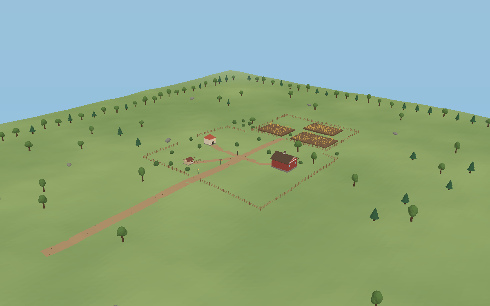

# AI World Builder

A free-first, local-first 3D world editor for the browser. Describe a world in
text, inspect and edit it in a Three.js viewport, save it locally, and export it
as a project file or a glTF 2.0 model for Godot and Unity.

> **Phase 3 status:** prompts now become a validated, versioned WorldPlan that is
> built by a structured procedural planner — including a complete cartoon farm
> with a farmhouse, barn, wheat fields, chicken coop, fences, lanes, orchard and
> optional river/bridge. Every generated object is editable, and one object or a
> whole region can be re-rolled in place. Full audit, architecture, risks and
> remaining work are in [`docs/ARCHITECTURE.md`](docs/ARCHITECTURE.md).

---

## What works today

- **3D viewport (real WebGL 2)** — a live `THREE.WebGLRenderer` on a WebGL 2
  context with ACES filmic tone mapping, sRGB output, PCF soft shadows, a
  procedural **shader sky** (gradient + sun disc that follows the world sun),
  **animated water** (GLSL ripple injected into the PBR material), orbit/pan/zoom
  for mouse and touch, grid and ground plane, terrain, click/tap selection with
  outlines, double-click framing, and a move/rotate/scale **gizmo** with
  world/local space and snapping. The HUD reports the live GPU API, FPS and draw
  calls, and the camera button exports the current frame as a PNG.
- **Procedural worlds** — five terrain styles (hills, flat, mountains, dunes,
  islands), seeded object scatter, settlements, ruins, lanterns, palms, cacti,
  biome palettes and day/sunset/night lighting.
- **Structured farm generation** — the planner lays out a real farm instead of
  scattering primitives: a grounded farmhouse, gabled barn with lean-to and hay,
  grain silo, chicken coop with run and chickens, fenced wheat fields with
  instanced crops, connecting dirt lanes that follow the terrain, an orchard,
  windbreak trees, and an optional creek with a planked bridge. Footprints are
  collision-checked against a spatial grid, so solids do not intersect.
- **Text-to-world generation** — a deterministic, fully offline interpreter maps
  descriptions to biome, style, scale, density, time of day, water and farm
  features, then a seeded planner produces a **WorldPlan v3**. The same
  description and seed rebuild the same world; matched cues and generation
  warnings are shown in the UI.
- **Validate before build** — every plan is checked structurally (Zod +
  hierarchy) and semantically (unsupported geometry, out-of-bounds objects,
  floating/buried solids, overlapping buildings, a bridge without a river).
  Blocking errors stop generation; warnings are reported and recoverable
  problems can be repaired.
- **Scene hierarchy** — a real tree (`role="tree"`) with groups, parent/child
  nesting up to 8 levels, inline rename, filter, per-node visibility and lock
  (both inherited by children), multi-select and reparent-by-grouping.
- **Transform editing** — drag the gizmo or type exact **position / rotation
  (XYZ degrees) / scale** values in the inspector, which also shows world-space
  values for grouped nodes. Snapping: 0.5 units, 15°, 0.1 scale.
- **Editor operations** — group, ungroup, duplicate (deep copy with new IDs),
  delete, snap-to-ground, colour and material editing (roughness, metalness,
  emissive), asset library (now incl. barn, coop, bush, dirt path, fence, wheat
  field and bridge), undo/redo and keyboard shortcuts (below).
- **Regenerate in place** — the inspector shows each object's geometry id,
  source, status, region and variation seed. **Regenerate** re-rolls that
  object's species/shape/palette/crop pattern without moving it; **Region**
  re-rolls every generated object in the same region. Both are single undo steps
  and only the affected scene nodes are rebuilt.
- **Local saving** — debounced autosave to IndexedDB, manual “Save now”, a
  multi-world library (open, duplicate, delete), in-app status, import/export of
  `.world.json` project files, and a session fallback when IndexedDB is blocked.
  Damaged project files are repaired on import (unreadable nodes dropped,
  orphans re-rooted, cycles broken) with visible warnings.
- **Export** — lossless WorldPlan JSON and binary glTF 2.0 (`.glb`) built from
  the same scene as the viewport. The glTF exporter is lazy-loaded.
- **Responsive UI** — desktop three-column layout (scene tree, viewport with
  floating toolbar, inspector) and a mobile layout with a bottom dock, bottom
  sheet, touch orbit + pinch-zoom, safe-area handling and 16 px inputs.

No paid APIs, accounts, telemetry or remote assets are used. All generation,
rendering, saving and exporting happens in the browser.

### What is deliberately not there yet

No placeholder buttons or mock features are shipped:

- The “AI” is a **deterministic rule-based planner**, not an LLM. A local LLM can
  implement the existing `PromptInterpreter` interface later.
- No click-to-place on terrain, box selection or terrain sculpting yet. Buildings
  are grounded, but terrain edits do not re-snap existing objects.
- GLB export has geometry/materials/vertex colours but no lights, colliders,
  LODs or native Godot/Unity project files.
- The WebGL rendering path could not be visually tested in the development
  sandbox (no GPU); real desktop/Android QA remains the first task.
- Farm layouts are authored around one yard template with seeded mirroring and
  variation; larger settlements/road graphs are future work.

Full risk list and roadmap: [`docs/ARCHITECTURE.md`](docs/ARCHITECTURE.md).

---

## Quick start

Requirements: **Node.js 20.19+ or 22.12+** (Vite 7). No API keys or environment
variables are needed.

```bash
npm install
npm run dev        # http://localhost:5173
```

Production build:

```bash
npm run build
npm run preview    # serves dist/ on http://localhost:4173
```

---

## Scripts

| Command | Purpose |
| --- | --- |
| `npm run dev` | Vite dev server bound to `0.0.0.0`. |
| `npm run build` | Strict type-check, then production build to `dist/`. |
| `npm run preview` | Preview the production build. |
| `npm run typecheck` | `tsc --noEmit` with strict settings. |
| `npm test` | Vitest: schema/migration, farm + scatter generation, validation/repair, regeneration, persistence, export, store, procedural scene, DOM runtime. |
| `npm run test:watch` | Watch mode. |
| `npm run schema:export` | Regenerate `docs/worldplan.schema.json` from the Zod schema. |
| `npm run render:preview` | Render a generated world to a PNG with a dependency-free software rasteriser (visual QA without a GPU). |

---

## Project structure

```
src/
  app/                 React entry composition
  core/
    world-plan/        WorldPlan v3 schema, factory, migration, hierarchy, transform math,
                       generation metadata, geometry registry, semantic validation, colours
    generation/        seeded RNG, terrain sampler, biomes, scatter generator, farm planner,
                       spatial placement ledger, per-object/region regeneration, starter
    assets/            procedural asset library, structures (barn/coop/silo/path/fence/field/river/bridge)
    persistence/       IndexedDB/memory repositories, project file I/O
    export/            glTF 2.0 (.glb) exporter + export target metadata
    scene/             shared Three.js scene builder (viewport + exporter), kit + Phase 3 geometry
    utils/             IDs, hashing, clamping
  modules/
    ai/                intent types, provider contract, offline interpreter
    editor/            reducer store, autosave, gizmo viewport, toolbar, hierarchy/inspector panels, shell
  ui/                  icons, controls, top bar, library dialog, export menu, toast
  styles/              design tokens + responsive CSS
  test/                Vitest setup (fake IndexedDB, GLB FileReader shim)
scripts/               schema export, offline preview renderer
docs/                  architecture report, WorldPlan reference, JSON Schema
```

Key design rule: the **WorldPlan document is the only source of truth**, and the
viewport and exporters share one scene builder. React never owns scene objects
outside the viewport component, and all hierarchy edits (group, ungroup,
reparent, duplicate) are pure functions over the document — the gizmo only
reports back a transform, which the reducer sanitises and records for undo.

---

## Saving and backup

Worlds autosave to this browser's IndexedDB after ~0.65 s of inactivity and are
listed in the world library. Browser storage can be cleared by the user, the
browser or private mode, so use **Export → Project file** for anything important.
Project files are self-contained, versioned and re-importable; they are also the
way to move worlds between devices.

The document format is documented in [`docs/WORLDPLAN.md`](docs/WORLDPLAN.md),
with a generated JSON Schema at
[`docs/worldplan.schema.json`](docs/worldplan.schema.json).

---

## Exporting to Godot and Unity

**Export → 3D model** produces a binary glTF 2.0 file:

- **Godot 4** imports `.glb` natively (drag it into the project).
- **Unity** needs a free glTF importer package; the file is standard glTF 2.0.
- Materials use PBR metallic-roughness with vertex colours on the terrain.
- Lights, collision and LODs are not exported yet.

**Export → Project file** is the lossless format for re-opening in this editor.

---

## Rendering

The viewport is a genuine WebGL 2 renderer, not a 2D fallback:

| Layer | Implementation |
| --- | --- |
| Context | `WebGLRenderer` with WebGL 2; retries with simpler attributes if a device rejects antialiasing or `high-performance` |
| Colour | ACES filmic tone mapping, sRGB output, PCF soft shadows |
| Sky | Custom GLSL dome: zenith/horizon gradient plus a physically aligned sun disc and glow |
| Water | PBR water with a per-pixel ripple injected into the standard shader (no textures, no extra pass) |
| Performance | Pixel-ratio cap, lower shadow resolution and point-light budget on phones, automatic resolution step-down if FPS stays below 28 |
| Resilience | GPU context-loss recovery, clear WebGL 2 error message with a retry button |
| Proof | Live HUD: `WebGL 2 · <fps> fps · <draws> draws`; hover for the GPU/vendor string. Camera button exports a PNG of the current frame |

Everything is local: no textures, CDNs or network requests are involved.

---

## Keyboard shortcuts

| Shortcut | Action |
| --- | --- |
| `G` / `R` / `S` | Move / Rotate / Scale gizmo |
| `X` / `Y` / `Z` | Toggle the X / Y / Z gizmo handles |
| `F` | Frame the selection (or the whole world) |
| `Ctrl/Cmd+S` | Save now |
| `Ctrl/Cmd+Z` / `Ctrl/Cmd+Shift+Z` (or `Ctrl+Y`) | Undo / Redo |
| `Ctrl/Cmd+G` / `Ctrl/Cmd+Shift+G` | Group / Ungroup selection |
| `Ctrl/Cmd+D` | Duplicate selection |
| `Ctrl/Cmd+A` | Select everything |
| `Delete` / `Backspace` | Delete selection |
| `Esc` | Clear selection / close the open panel |
| `Enter` / `Space` / `F2` in the tree | Select / rename a focused node |

On touch devices the same operations are available from the bottom dock, the
scene tree's per-row buttons and the inspector.

---

## Try the acceptance scenario

### Farm pipeline (Phase 3)



*The farm brief above, generated deterministically (seed 20261020) and rendered
straight from the scene graph that the viewport builds. Reproduce it with
`npm run render:preview`.*

1. Open **AI** and use the first example: *“Create a large cartoon low-poly farm
   with a farmhouse, barn, wheat fields, a chicken coop, fences, trees, and
   connected dirt paths.”* Press **Generate world**.
2. Inspect the result in **Scene**: Farmstead (Barn, Farmhouse, Chicken coop),
   Wheat fields, Paths, Fences and Landscape groups.
3. Select the farmhouse and change position/rotation in **Inspect**; open
   **Generated** and press **Regenerate** on the barn, or **Region** to re-roll
   every field.
4. Press **Save now**, reopen the project from the library, and confirm the farm
   and your edits are intact.

### Editor baseline (Phase 2)

1. Open **Assets** and add **Ground plane**, **Cube**, **Pine tree** and **House**.
2. Select each one in the **Scene** tree (or tap it in the viewport) and use the
   gizmo — or type exact values in the **Inspect** panel: position, rotation
   (XYZ degrees) and scale.
3. Shift-click the tree and house, press **Group** (`Ctrl/Cmd+G`), then move and
   rotate the group.
4. Press **Save now** and reload the page: the world is restored from IndexedDB
   with every transform and hierarchy entry intact.
5. Repeat the transform steps on Android Chrome to confirm touch orbit,
   tap selection and the inspector sheet.

---

## Tech stack

React 19 · TypeScript 5.9 · Vite 7 · Three.js r186 · Zod 4 · IndexedDB · Vitest ·
Testing Library · happy-dom · fake-indexeddb. All open source, no paid services.

---

## Verification (Phase 3)

- `npm run typecheck` — clean (strict, `noUncheckedIndexedAccess`).
- `npm test` — **113 tests / 13 files passing**, including a real binary GLB
  parse, IndexedDB CRUD, deterministic generation, farm planning, semantic
  validation/repair, regeneration, hierarchy/transform math, the gizmo's API
  contract, and DOM runtime flows on desktop and mobile widths.
- **Farm acceptance (UI)**: prompt → plan → generated hierarchy → edit farmhouse
  position/rotation → regenerate the barn → save → reopen → transform and farm
  content verified.
- **Editor acceptance**: ground plane + cube + tree + house → move/resize/rotate
  → group → save → reload → every transform and hierarchy entry verified in the
  document **and** the rendered scene graph.
- `npm run build` — success. Initial gzip payload ≈ 309 kB; exporter deferred.
- Dev and preview servers return HTTP 200 for all assets through a proxied host.
- Real WebGL/GPU and physical-device testing remains outstanding (see risks).

---

## Roadmap

Phases 1–3 are complete pending real-device acceptance on desktop and Android.
Next: click-to-place and terrain snapping → terrain sculpting/flattened building
pads → performance profiling at 500+ objects → optional local-LLM provider →
richer asset pipeline → native engine exports → PWA/offline install. Details and
acceptance criteria are tracked in the architecture report.
